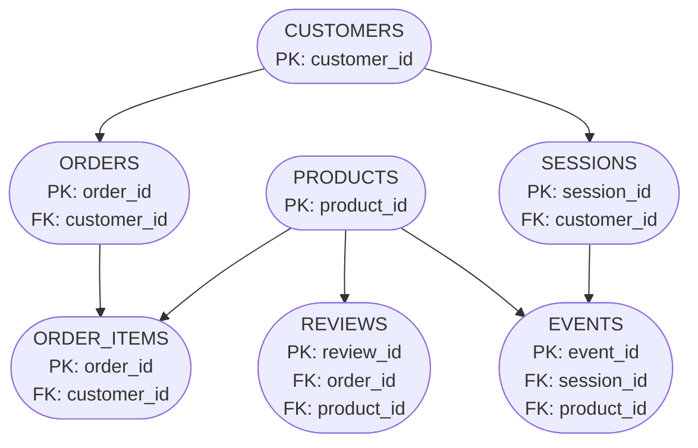
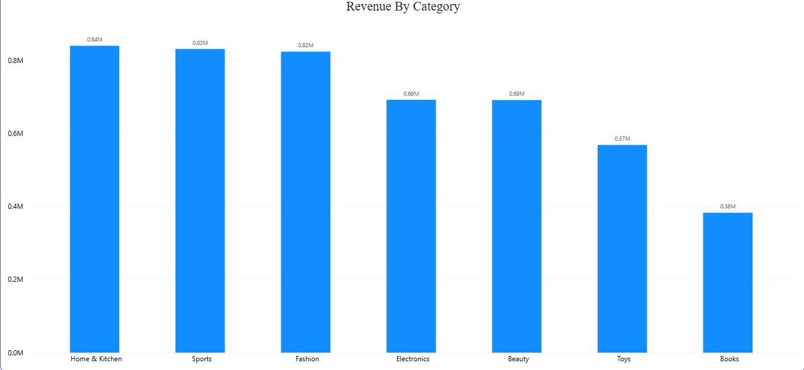
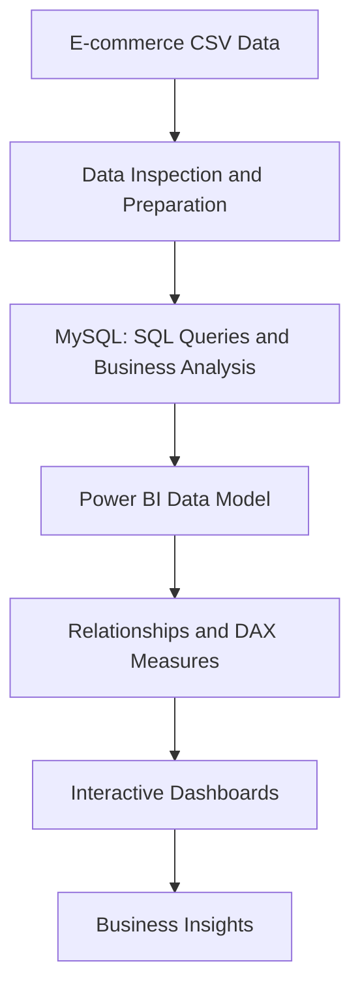

# E-commerce Sales and Customer Analytics

This project analyzes e-commerce sales, customer behaviour, product profitability, customer reviews, marketing channels, and website activity using SQL, MySQL, and Power BI. It combines transactional and customer data to identify business patterns, evaluate sales performance, and understand factors associated with repeat purchases and profitability.

---

## Project Objective

The goal of this project is to explore e-commerce performance across sales, customers, products, and website interactions, answering key business questions such as:

- How do revenue, profit, and order volume change over time?
- Which product categories and products generate the most revenue and profit?
- How do sales volume and profitability vary across products?
- How do discounts relate to profit margins?
- What proportion of purchasing customers make repeat purchases?
- Do purchasing patterns differ between customer age groups?
- How are product ratings distributed, and are ratings associated with sales or profitability?
- Which acquisition sources and devices generate higher-value orders?
- How does customer activity progress from page views to purchases?
- Do customers return to purchase again in the months following their first order?

---

<table>
  <tr>
    <td></td>
    <td></td>
  </tr>
  <tr>
    <td></td>
    <td>    </td>
  </tr>
</table>

## Project Structure

---

## Tools & Technologies

- **Python** – Data inspection and preparation, where applicable.
- **SQL / MySQL** – Data querying, aggregation, and business analysis.
- **Power BI** – Dashboard development, data visualization, DAX measures, and interactive reporting.
- **Power Query** – Data import, inspection, and preparation.
- **Git & GitHub** – Version control and project documentation.
- **Mermaid** – Generate diagrams from plain text.

---

## Dataset

The project uses a multi-table e-commerce dataset containing seven tables.

| Table | Description |
|---|---|
| `customers` | Customer information, age, country, signup date, and marketing preferences. |
| `orders` | Order dates, payment methods, discounts, order totals, country, device, and acquisition source. |
| `order_items` | Products purchased, unit prices, quantities, and line totals. |
| `products` | Product names, categories, prices, costs, and margins. |
| `sessions` | Website session information, including start time, device, source, and country. |
| `events` | Website interactions, including page views, add-to-cart activity, and purchases. |
| `reviews` | Customer review data used for product-rating analysis. |

The data supports analysis at multiple levels, including individual orders, order items, customers, products, sessions, and website events.

---

## Data Preparation and Modelling

Key steps included:

- Inspecting the source tables and their columns.
- Reviewing data types and data quality.
- Documenting relationships between tables.
- Loading and querying data using MySQL.
- Creating SQL queries to investigate business questions.
- Establishing relationships between tables in Power BI.
- Creating DAX measures for revenue, profit, orders, average order value, customer counts, and retention analysis.
- Building visualizations to compare sales performance and customer behaviour.

---

## Analysis Questions

The project investigates the following areas.

### 1. Sales Performance

- How do revenue and profit change over time?
- Which product categories generate the highest revenue?
- What are the total order volume and average order value?
- How do revenue and profitability compare across products?

### 2. Product Profitability and Discounts

- Which products contribute the most profit?
- Do products with higher revenue also generate higher profit?
- How do profit margins vary across discount levels?
- Are highly rated products associated with greater revenue or profitability?

### 3. Customer Behaviour and Demographics

- How many customers are one-time buyers versus repeat buyers?
- How many customers have not placed an order?
- Does revenue per purchasing customer differ across age groups?
- How are customer reviews distributed across rating categories?

### 4. Marketing and Website Performance

- Which acquisition sources generate the most revenue and orders?
- How does average order value vary by acquisition source?
- Do acquisition source and device combinations show differences in order value?
- How many sessions progress from page viewing to adding products to a cart and completing a purchase?

### 5. Customer Retention

- When did each customer make their first purchase?
- What proportion of customers from each first-purchase cohort return in subsequent months?
- How does repeat purchasing activity change over time?

---

## Power BI Dashboard

The Power BI report presents the results of the analysis through a series of focused visualizations.

### Sales Performance

- Total revenue, total profit, total orders, and average order value.
- Monthly revenue trends.
- Revenue by product category.
- Product revenue versus profitability.

### Customer and Product Insights

- One-time versus repeat purchasing customers.
- Top products by profit.
- Discount levels and profitability.
- Customer age groups and spending patterns.
- Product review-rating distribution.
- Product ratings compared with revenue or profit.

### Marketing and Website Funnel

- Revenue by acquisition source.
- Order volume and average order value by source.
- Acquisition source and device performance matrix.
- Website session funnel analysis.
- Sales performance by country.

### Customer Cohort Retention

- Customer cohorts based on their first-purchase month.
- Retention percentages across subsequent months.
- Conditional formatting to highlight differences between cohorts.

---

## Dashboard Preview

The following images provide an overview of the Power BI report:

https://github.com/lucybbbb/E-commerce-sales-and-customer-analytics/blob/main/docs/data_dictionary.md
https://github.com/lucybbbb/E-commerce-sales-and-customer-analytics/blob/main/docs/ecommerce-pbi.pdf
---

## Key Findings

The following findings were identified during the analysis.

- **Repeat purchasing is significant:** Of 16,268 customers with at least one order, 10,045 were repeat buyers and 6,223 were one-time buyers. Repeat buyers represented approximately **61.8% of purchasing customers**.
- **Some customers have not purchased:** Of the 20,000 customers in the dataset, 3,732 had no recorded orders.
- **Revenue across the compared age groups is relatively similar:** Customers aged 36–45 generated approximately **$770K** in total revenue, while customers over 65 generated approximately **$750K**. These figures represent total revenue, not average spending per customer.
- **Profitability varies across products:** Within the selected top-15 product comparison, Mouse Rosy generated approximately **$3,011 in profit from 55 units sold**, compared with approximately **$2,718 in profit from 38 units** for Tennis Racket Azure.
- **Product ratings do not necessarily correspond to profitability:** In the selected product comparison, Mouse Rosy generated more profit than Tennis Racket Azure despite having a lower customer rating.

The remaining analyses explore discount levels, acquisition sources, device performance, website activity, and customer retention to identify additional patterns in the data.

---

## Analysis Workflow

---

## Files Included

### SQL

SQL scripts used to investigate sales, profitability, customer purchasing patterns, product performance, marketing activity, and website events.

### Power BI

The Power BI report contains visualizations for sales performance, customer and product insights, marketing and website behaviour, and customer cohort retention.

### Docs

The `docs/` folder can contain dashboard screenshots and an exported version of the Power BI report for convenient viewing.

### Python 

The `python/` folder contains the analysis, cleaning of the dataset. 
---

## Conclusion

This project demonstrates the use of SQL and Power BI to investigate e-commerce business performance across multiple related datasets. It moves beyond basic sales reporting to explore profitability, customer purchasing behaviour, product reviews, marketing channels, website conversion, and customer retention.

The analysis highlights how data can help businesses understand where revenue and profit are generated, identify customer behaviour patterns, and determine which areas deserve further investigation.

---

## Author

**Luciana Bujor**

Aspiring Data Analyst | SQL | MySQL | Power BI | Data Analysis | Business Intelligence   | Mermaid
