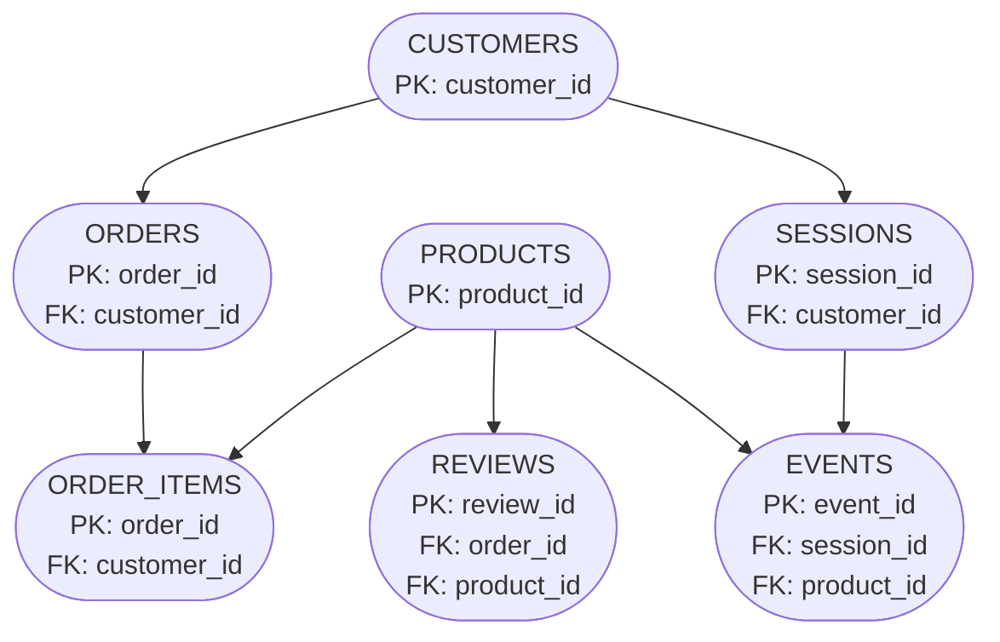

# E-commerce Data Dictionary

This document describes the structure, meaning, keys, relationships, and data-quality characteristics of the datasets used in the e-commerce analysis project.

---

## Table Overview

Data model

| Table       | Description                     | Grain                                               | Primary Key      | Foreign Keys                                                             |
| ----------- | ------------------------------- | --------------------------------------------------- | ---------------- | ------------------------------------------------------------------------ |
| customers   | Customer information            | One row represents one customer.                    | customer_id      | none                                                                     |
| orders      | Order information               | One row represents one order                        | order_id         | customer_id ->customers.customer_id                                      |
| order_items | Products associated with orders | One row represents one product line within an order | no PK identified | order_id ->orders.order_id product_id ->products.product_id        |
| products    | Product information             | One row represents one product                      | product_id       | none                                                                     |
| reviews     | Customer product reviews        | One row represents one review                       | review_id        | order_id ->orders.order_id product_id ->products.product_id        |
| sessions    | Website sessions                | One row represents one website session              | session_id       | customer_id-> customers.customer_id                                      |
| events      | Customer/user website events    | One row represents one website events               | event_id         | session_id ->sessions.session_id product_id ->products.product_id  |

---

# 1. Customers

## Table purpose

Contains information about individual customers.

## Grain

One row represents one customer.

## Primary key

customer_id

###### Data quality

-Total rows: 20000

-Customer IDs: 20000 unique

-Missing customer IDs: 0

## Columns

| Column           | Data Type | Description | Key / Role | Missing Values | Notes        |
| ---------------- | --------- | ----------- | ---------- | -------------: | ------------ |
| customer_id      | int64     |             | PK         |              0 | 20000 Unique |
| name             | object    |             | Attribute  |              0 | 17915 unique |
| email            | object    |             | Attribute  |              0 | 20000 unique |
| country          | object    |             | atribute   |              0 | 17 unique    |
| age              | int64     |             | measure    |              0 | 58 unique    |
| signup_date      | object    |             | date/time  |              0 | 2131 unique  |
| marketing_opt_in | bool      |             | attribute  |              0 | 2 unique     |

# 2. Orders

## Table purpose

Contains information about orders.

## Grain

 One row is one order.

## Primary key

order_id

## Foreign keys

customer_id -> customers.customer_id

###### Data quality

-Customer IDs used in orders: 16268

-Orphan customer IDs: 0

## Columns

| Column         | Data Type | Description | Key / Role | Missing Values | Notes        |
| -------------- | --------- | ----------- | ---------- | -------------: | ------------ |
| order_id       | int64     |             | PK         |              0 | 33580 unique |
| customer_id    | int64     |             | FK         |              0 | 16268 unique |
| order_time     | object    |             | date/time  |              0 | 33578 unique |
| payment_method | object    |             | measure    |              0 | 4 unique     |
| discount_pct   | int64     |             | measure    |              0 | 5 unique     |
| subtotal_usd   | float64   |             | measure    |              0 | 15227 unique |
| total_usd      | float64   |             | measure    |              0 | 16934 unique |
| country        | object    |             | atribute   |              0 | 17 unique    |
| device         | object    |             | attribute  |              0 | 3 unique     |
| source         | object    |             | attribute  |              0 | 6 unique     |

---

# 3. Order Items

## Table purpose

Information about individual products within orders.

## Grain

One product line with a product.

## Primary key

Not identified, order_id and product_id not unique.

## Foreign keys

order_id ->orders.order_id

product_id --> products.product_id

###### Data quality

-Total rows: 59163

-Missing values: 0

-Duplicates: 73

## Columns

| Column              | Data Type | Description | Key / Role | Missing Values | Notes        |
| ------------------- | --------- | ----------- | ---------- | -------------: | ------------ |
| order_id            | int64     |             | FK         |              0 | 33580 unique |
| product_id          | int64     |             | FK         |              0 | 1195 unique  |
| unit_price_usd      | float64   |             | Measure    |              0 | 1159 unique  |
| quantity            | int64     |             | measure    |              0 | 4 unique     |
| line_total_usdint64 | float64   |             | Measure    |              0 | 3804 unique  |

---

# 4. Products

## Table purpose

Contains information about the products available in the e-commerce dataset, including product category, name, selling, and margin.

## Grain

One row represents one product.

## Primary key

product_id

FK - none.

###### Data quality

- total rows: 1197

-missing values: 0

-duplicate rows: 0

## Columns

| Column     | Data Type | Description           | Key / Role | Missing Values | Notes        |
| ---------- | --------- | --------------------- | ---------- | -------------: | ------------ |
| product_id | int64     | unique identifier     | PK         |              0 | 1197 unique  |
| category   | object    | product category      | attribute  |              0 | 7 categories |
| name       | object    | product name          | attribute  |              0 | 1197 unique  |
| price_usd  | float64   | selling price         | measure    |              0 | 1161 unique  |
| cost_usd   | float64   | cost of the product   | measure    |              0 | 1157 unique  |
| margin_usd | float64   | product margin in usd | measure    |              0 | 1096 unique  |

---

# 5. Reviews

## Table purpose

Contains customer review information associated with products and orders, including the rating, review text, and time of the review.

***Contains one of five predefined review-text templates corresponding to five rating levels, it does not represent unique free-form customer comments.

## Grain

One row represents one customer review.

## Primary key

To be confirmed.

## Foreign keys

review_id - unique across all 10780 rows

FK: order_id -> orders.order_id

      product_id ->products.product_id

###### Data quality

-total rows: 10780

-missing values: 0

-duplicate rows:  0

-rating has five unique values and should be checked to confirm the expected rating scale

## Columns

| Column      | Data Type | Description                        | Key / Role | Missing Values | Notes        |
| ----------- | --------- | ---------------------------------- | ---------- | -------------: | ------------ |
| review_id   | int64     | unique identifier                  | PK         |              0 | 10780 unique |
| order_id    | int64     | identifier of the order            | FK         |              0 | 6111 unique  |
| product_id  | int64     | identifier of the reviewed product | FK         |              0 | 1140 unique  |
| rating      | int64     | numerical rating                   | measure    |              0 | 5 unique     |
| review_text | object    | content of the customer review     | attribute  |              0 | 5 unique     |
| review_time | object    | data/time                          | date       |              0 | 2117 unique  |

---

# 6. Sessions

## Table purpose

Contains information about customer website sessions, including the session started, the device used, the traffic source, adn the customer's quality.

## Grain

One row represents one website session.

## Primary key

session_id

## Foreign keys

customer_id -> customers.customer_id

Data quality

-total rows: 120000

-missing values: 0

-duplicate rows: 0

## Columns

| Column      | Data Type | Description                         | Key / Role | Missing Values | Notes         |
| ----------- | --------- | ----------------------------------- | ---------- | -------------: | ------------- |
| session_id  | int64     | unique identifier                   | PK         |              0 | 120000 unique |
| customer_id | int64     | identifier of customer              | FK         |              0 | 19945 unique  |
| start_time  | object    | date/time                           | date/time  |              0 | 119962 unique |
| device      | object    | device type used during session     | attribute  |              0 | 3 unique      |
| source      | object    | traffic source                      | atribute   |              0 | 6 unique      |
| country     | object    | country associated with the session | attribute  |              0 | 17 unique     |

---

# 7. Events

## Table purpose

Individual website/user interaction events.

## Grain

One row represents one website event.

## Primary key

event_id

## Foreign keys

-session_id -> sessions.session_id

-product_id -> products.product_id

###### Data quality

-total rows: 790958

-missing values occur in: product_id, qty, cart_size, payment, discount_pct, amount_usd

-no missing values in: event_id, session_id, timestamp, event_type

-duplicate rows: 0

-event_id is unique

## Columns

| Column       | Data Type | Description                                        | Key / Role | Missing Values | Notes         |
| ------------ | --------- | -------------------------------------------------- | ---------- | -------------: | ------------- |
| event_id     | int64     | unique identifier                                  | PK         |              0 | 760958 unique |
| session_id   | int64     | identifier of the website                          | FK         |              0 | 120000 unique |
| payment      | object    | payment related information recorded for the event | attribute  |         727378 | 5 unique      |
| discount_pct | float64   | discount percentage associated with the event      | measure    |         727378 | 6 unique      |
| amount_usd   | float64   | amount associated with the event                   | measure    |         727378 | 16935 unique  |

---

# Relationships

The following relationships have been identified as potential relationships and are being validated:

- customers → orders
- orders → order_items
- products → order_items
- sessions → events
- products → reviews

Final cardinality and foreign-key validation will be documented after validation.

---

# Data Quality Notes

Data-quality checks performed:

- Missing values checked
- Duplicate rows checked
- Potential identifier columns checked
- Shared ID columns checked
- Referential relationships checked
